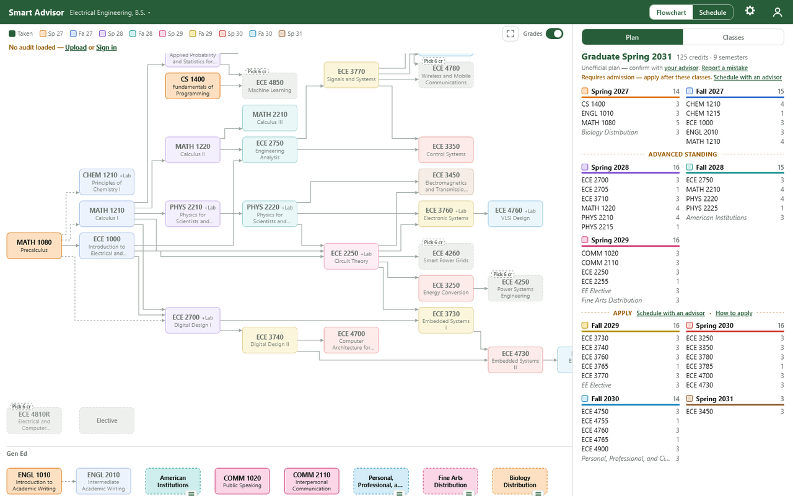
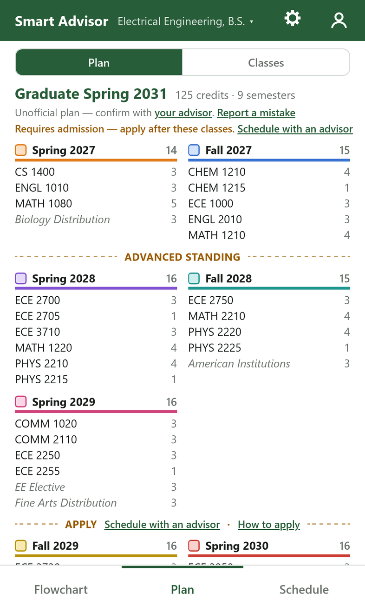
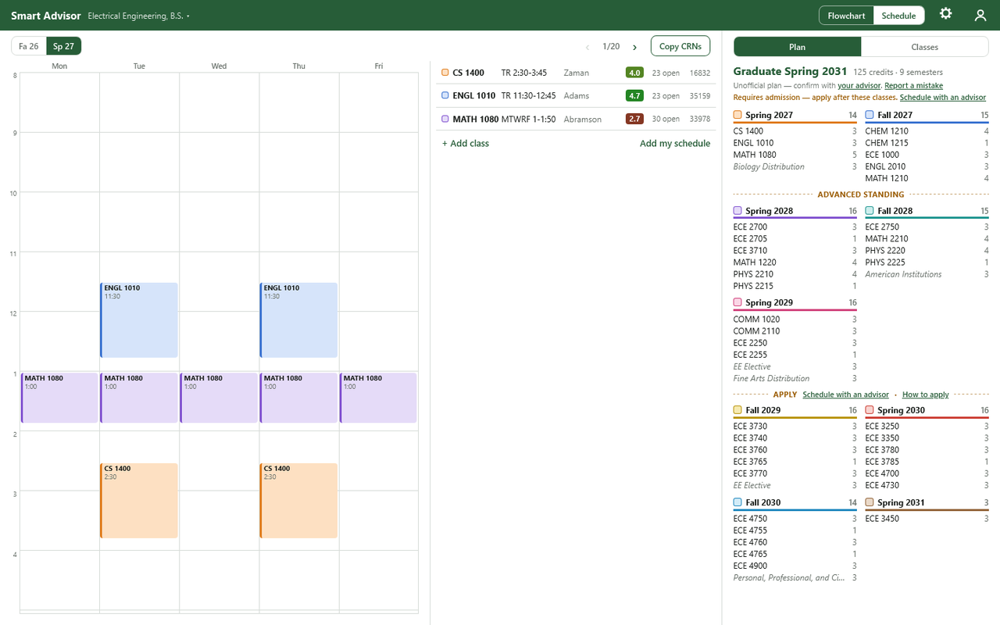

# Smart Advisor (UVU)

A free web app for Utah Valley University students: prerequisite flowcharts for any major, an automatic semester-by-semester plan to graduate on time, a schedule builder for upcoming sections (times + professors), and Rate My Professors ratings on each section. Plain HTML/CSS/JS hosted on GitHub Pages; course data comes from UVU's public catalog. Open `index.html` or the live site at https://timothyhadfield.github.io/smart-advisor/.

  
  &nbsp;
  

  

